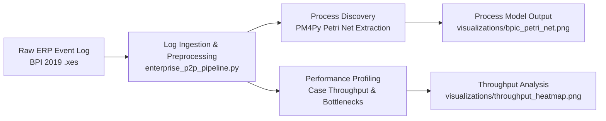
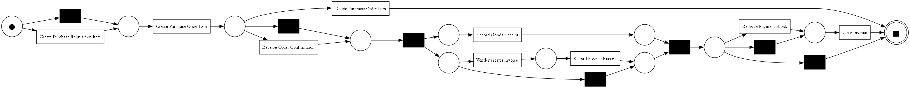

# Enterprise P2P Process Discovery & Bottleneck Analysis (PM4Py)

An automated process mining pipeline built with **PM4Py** to reconstruct Procure-to-Pay (P2P) workflows from enterprise ERP event logs, extract Petri net process models, and identify throughput bottlenecks.

## Problem Statement
Enterprise Procure-to-Pay (P2P) workflows span multiple ERP modules—purchase requisitions, vendor approvals, goods receipts, and invoice clearing. Standard BI dashboards report aggregate KPIs but obscure hidden rework loops, compliance deviations, and cycle-time bottlenecks buried in raw transaction logs.

This repository provides a reproducible Python pipeline that ingests standardized XES event logs (tested on the **BPI Challenge 2019** dataset), discovers the underlying control-flow graph, and exports process and throughput visualizations.

---

## Pipeline Architecture



---

## Discovered Outputs

### Procure-to-Pay Petri Net Model


### Cycle-Time & Throughput Profile


---

## Quick Start

### 1. Environment Setup
Ensure the **Graphviz** system binary is installed and available on your `PATH` (required by PM4Py for Petri net rendering), then install Python dependencies:
```bash
python -m venv venv
pip install -r requirements.txt
```

### 2. Dataset Placement
Download the public **BPI Challenge 2019** Procure-to-Pay `.xes` event log (excluded from version control due to file size) and place it inside the `data/` directory.

### 3. Run the Discovery Pipeline
```bash
python enterprise_p2p_pipeline.py
```
Generated diagrams are written to `visualizations/`.

---

## Project Structure
```text
Enterprise-Process-Discovery-PM4Py/
├── enterprise_p2p_pipeline.py   # End-to-end XES ingestion, discovery, and visualization script
├── requirements.txt             # Pinned Python dependencies (pm4py, pandas, matplotlib, graphviz)
├── data/                        # Local directory for raw .xes event logs (gitignored)
└── visualizations/              # Exported Petri net and performance diagrams
```

## Planned Iterations
* **Log Characterization Metrics:** Quantify transactional log density, trace variant entropy, and support distributions prior to mining.
* **Conformance & Clustering:** Add trace-level variant clustering and replay fitness evaluation.