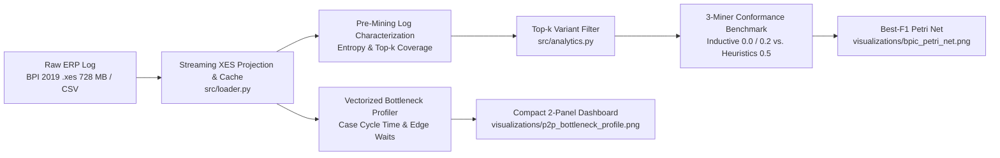
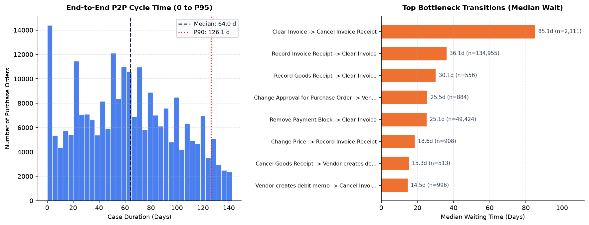

# Enterprise P2P Process Discovery, Conformance Benchmarking & Bottleneck Analysis

A modular **PM4Py** process mining pipeline built to characterize high-noise enterprise ERP event logs, benchmark Petri net discovery algorithms across conformance dimensions (Fitness, Precision, F1, Simplicity), and profile end-to-end Procure-to-Pay (P2P) cycle-time bottlenecks.

## Problem Statement
Enterprise Procure-to-Pay (P2P) workflows span purchase requisitions, approvals, goods receipts, payment blocks, and invoice clearing. Traditional BI dashboards report aggregate averages that mask rework loops, long-tail variant noise, and transition-level delays. At the same time, naive process discovery over raw ERP exports typically fails in two ways:
1. **Memory & I/O Failure:** Loading 700+ MB XML `.xes` logs into full-DOM object matrices exhausts memory when only core control-flow attributes are required.
2. **"Spaghetti Model" Overfitting:** Running discovery blindly across thousands of rare trace variants produces unreadable models without quantifying coverage or conformance trade-offs.

This pipeline addresses both bottlenecks through streaming XML column projection, pre-mining variant entropy profiling, head-to-head miner conformance benchmarking, and vectorized bottleneck extraction.

---

## Pipeline Architecture



---

## Empirical Validation (BPI Challenge 2019 — Full ERP Log)

### 1. Pre-Mining Log Characterization (Unfiltered)
Quantifying control-flow complexity before mining explains why unfiltered discovery degrades into spaghetti graphs and establishes an empirical basis for variant filtering:

| Metric | Observed Value |
| :--- | :---: |
| **Total Purchase Order Cases** | `251,734` |
| **Total Events** | `1,595,923` (`6.34` avg events/case) |
| **Unique Activities** | `42` |
| **Unique Trace Variants** | `11,973` (variant-to-case ratio: `0.0476`) |
| **Variant Shannon Entropy** | `6.243 bits` (normalized: `0.461`) |
| **Cumulative Case Coverage** | Top-5: `45.43%` · **Top-10: `59.45%`** · Top-20: `70.50%` · Top-50: `81.05%` |

---

### 2. Discovery Algorithm Benchmark (Top-10 Variants: 149,658 Cases / 59.45%)
Evaluated via **Token-Based Replay (TBR)** fitness and precision alongside arc-degree structural simplicity:

| Discovery Algorithm | TBR Fitness | TBR Precision | Harmonic F1 | Simplicity | Places / Trans. / Arcs | Discovery Time |
| :--- | :---: | :---: | :---: | :---: | :---: | :---: |
| **Inductive Miner (`noise=0.0`)** | **`1.0000`** | `0.8992` | `0.9469` | `0.7000` | `12 / 16 / 34` | `704–790 ms` |
| **Inductive Miner (`noise=0.2`)** | `0.9891` | `0.9545` | `0.9715` | **`0.7647`** | `12 / 14 / 30` | **`614–702 ms`** |
| **Heuristics Miner (`dep=0.5`)** | `0.9860` | **`0.9796`** | **`0.9828`** | `0.6216` | `10 / 13 / 30` | `1,734–2,000 ms` |

* **Architectural Trade-off:** `Inductive Miner (0.0)` guarantees perfect trace replay (`1.0000` fitness) and formal soundness at the expense of precision (`0.8992`). Introducing a `0.2` noise threshold yields the cleanest, simplest sound Petri net (`0.7647` simplicity, `0.9715` F1). `Heuristics Miner (0.5)` delivers peak precision (`0.9796`) and F1 (`0.9828`) by tightening direct-follows edges, though without Inductive Miner's formal soundness guarantee.

#### Discovered P2P Petri Net (Highest-F1 Model: Heuristics Miner `dep=0.5`)


---

### 3. End-to-End Cycle Time & Transition Bottlenecks (All 251,734 Cases)
* **Case Cycle-Time Distribution:** Mean **`71.52 d`** · Median **`64.04 d`** · P90 **`126.10 d`** · P95 **`142.30 d`**

| High-Volume Activity Transition (`n >= 500`) | Median Wait | Mean Wait | Volume (`n`) | Operational Friction Type |
| :--- | :---: | :---: | :---: | :--- |
| `Clear Invoice -> Cancel Invoice Receipt` | **`85.14 d`** | `84.45 d` | `2,111` | Post-clearing invoice reversal / dispute rework |
| `Record Invoice Receipt -> Clear Invoice` | **`36.06 d`** | `43.72 d` | **`134,955`** | Primary accounts-payable settlement bottleneck |
| `Record Goods Receipt -> Clear Invoice` | `30.10 d` | `44.02 d` | `556` | Direct goods-to-clearance settlement lag |
| `Change Approval for PO -> Vendor creates invoice` | `25.54 d` | `43.29 d` | `884` | Mid-stream approval rework delay |
| `Remove Payment Block -> Clear Invoice` | **`25.08 d`** | `36.33 d` | **`49,424`** | Post-block release clearing backlog |
| `Change Price -> Record Invoice Receipt` | `18.56 d` | `28.35 d` | `908` | Price-variance reconciliation lag |



---

## Engineering & Performance Notes
* **Streaming XES Projection Eliminates OOM:** Parsing the `728 MB` `BPI_Challenge_2019.xes` file via standard `pm4py.read_xes()` threw `_ArrayMemoryError` while attempting to allocate a `(1,595,923 × 21)` object array. Replacing full-DOM parsing with C-accelerated `xml.etree.ElementTree.iterparse` (projecting only `case:concept:name`, `concept:name`, `time:timestamp` and clearing XML elements per `<trace>`) parsed all 1.6M events cleanly in **`34.0 s`**.
* **206× Iterative Speedup via Core Cache:** Persisting the projected 3-column DataFrame to a gitignored local `.core.pkl` cache cut subsequent log loads from `34,008.7 ms` to **`165.1 ms`**.
* **PyArrow Compatibility & Compact Visuals:** Replacing Pandas tuple `value_counts()` with a single-pass `collections.Counter` resolved PyArrow `ArrowNotImplementedError` under modern Pandas string backends. Replacing an unfiltered Graphviz performance DFG (`21.0 MB`) with a vectorized 2-panel Matplotlib dashboard reduced visual size by **99.4%** (`117.9 KB`).

---

## Design Trade-offs & Scope

| Subsystem | Prototype Implementation | Production-Scale Architecture |
| :--- | :--- | :--- |
| **XES Ingestion** | Streaming `ElementTree.iterparse` + local `.core.pkl` cache | Partitioned Parquet / DuckDB event store fed directly from ERP CDC streams |
| **Conformance Replay** | Token-Based Replay (TBR) over Top-k variants (`~2 min` full benchmark) | Alignment-based conformance checking distributed across Spark / Ray workers |
| **Variant Filtering** | Explicit Top-k frequency cutoff justified by Shannon entropy & coverage curve | Trace clustering (k-medoids / actiTraC) to mine distinct procurement regimes separately |

---

## Quick Start

### 1. Environment Setup
Ensure the **Graphviz** system binary is installed (required for Petri net rendering), then install dependencies:
```bash
python -m venv venv
pip install -r requirements.txt
```

### 2. Run Automated Unit Tests (No 728 MB Dataset Required)
```bash
python -m pytest -v
```
All **7 tests** execute in memory using synthetic ERP DataFrames and mini-XES fixtures.

### 3. Run the Full BPI Challenge 2019 Benchmark
Download `BPI_Challenge_2019.xes` (excluded from version control due to size) into `data/`, then execute:
```bash
# Full run (supports --top-k, --min-freq, --input for CSV/XES, and --no-cache)
python enterprise_p2p_pipeline.py --top-k 10 --min-freq 500
```

---

## Project Structure
```text
Enterprise-Process-Discovery-PM4Py/
├── enterprise_p2p_pipeline.py             # CLI orchestrator (characterization, benchmark, profiling)
├── src/
│   ├── loader.py                          # Streaming XES projector, .pkl cache & ERP CSV normalizer
│   ├── analytics.py                       # Variant entropy, 3-miner TBR benchmark & bottleneck profiler
│   └── visualize.py                       # Petri net renderer & compact 2-panel Matplotlib dashboard
├── tests/
│   └── test_pipeline.py                   # 7 in-memory pytest cases (CSV, XES streaming, miners, charts)
├── visualizations/
│   ├── bpic_petri_net.png                 # Exported best-F1 Petri net
│   └── p2p_bottleneck_profile.png         # Compact 117.9 KB cycle-time & transition bottleneck dashboard
└── requirements.txt
```

---

## References
1. van der Aalst, W. M. P. (2016). *Process Mining: Data Science in Action* (2nd ed.). Springer.
2. van Dongen, B. F. (2019). *BPI Challenge 2019* [Procure-to-Pay ERP Event Log]. 4TU.ResearchData.
3. Berti, A., van Zelst, S. J., & Schuster, D. (2023). *PM4Py: A Process Mining Library for Python*. Software Impacts.